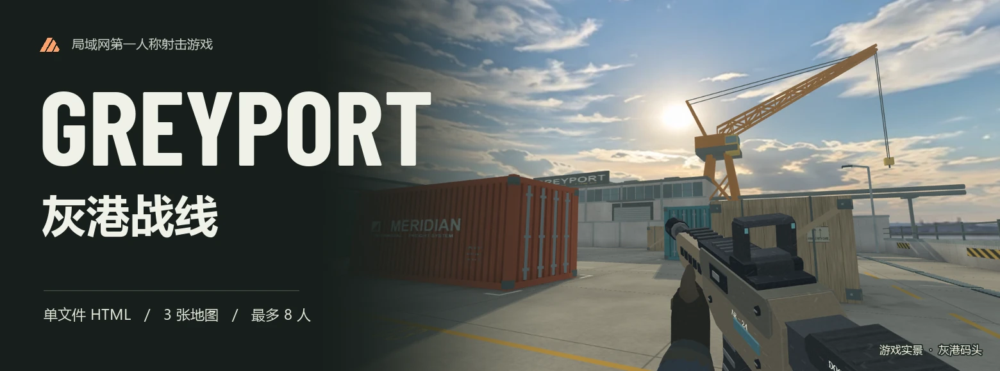
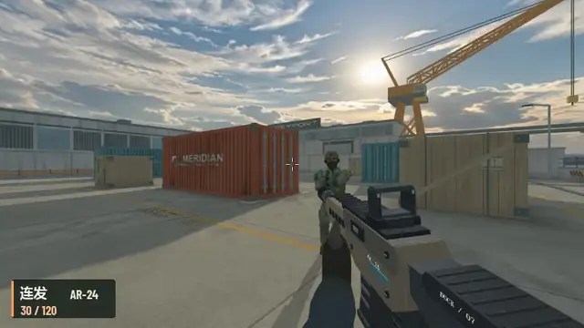

# 灰港战线 · GREYPORT ARENA



**不到 1 MB 的局域网第一人称射击游戏。打开链接进战区，下一个打开它的人就是你的对手。**

走出货柜的阴影，低悬的太阳让前景暗下来。隔壁通道响起弹匣扣合声，你按 **B** 切到连发。灰港的三张地图、武器、角色、光照和声音，都装在一个可以双击打开的 HTML 里。

**[⬇ 下载单文件游戏](https://github.com/LiuHaiYang/greyport-arena/releases/latest/download/greyport-arena.html)**　·　[快速开局](#快速开局)　·　[看实机演示](#第一视角)　·　[键鼠操作](#键鼠操作)　·　[技术细节](#拆开这个文件)

| 玩家 | 战区 | 对局 | 复活 | 下载体积 |
| :---: | :---: | :---: | :---: | :---: |
| 2–8 人 / 对局 | 3 张 · 各 48 × 40 米 | 5 分钟自由混战 | 15 秒 | 946,724 字节 |

## 快速开局

### 朋友已经发来了对局链接

连上和朋友相同的局域网，用支持 WebGL 的桌面浏览器打开链接，**直接进入同一局、同一张地图**。按 **WASD** 就能移动，第一次点击游戏画面会启用鼠标视角，再按左键才会开火。第一位玩家可以在地图里等人；第二位加入时，五分钟倒计时开始。

### 我想用自己的 Windows 电脑开局

1. 下载上方的 **`greyport-arena.html`**，双击进入地图。画面底部显示 **本机对局** 时就可以移动和射击；如果游戏检测到本机已有兼容的联机服务，会自动进入在线对局。
2. 点右上角 **分享对局**。看到 **对局地址** 时，直接把它发给朋友即可。看到 **让好友加入** 时，点 **复制启动命令**，在这台电脑的 **Windows PowerShell** 中粘贴并按回车。
3. 运行命令后，浏览器会打开同名、同地图的联机对局。在新页面点 **分享对局 → 复制对局地址**，把链接发给朋友。

游玩期间保持 PowerShell 窗口开启，也请房主保留游戏标签页。房主退出会结束这场对局；在启动服务的 PowerShell 窗口按回车会结束整台主机的联机服务。朋友只用浏览器，双方都无需安装 Node.js。游戏已经捕获鼠标时，可按 **Esc → 分享对局** 获取链接。

<details>
<summary><b>怎样换地图、和另一组朋友开局？</b></summary>

按 **Esc → 另开对局**，填写一个未被使用的对局名，选择地图，再点 **进入新对局**。新链接会带上这局的名字和地图。若你是原对局的房主，成功切换后原对局结束；若名称重复，你会留在原对局。每局最多 8 人，第 9 位玩家打开链接时会看到满员提示。

</details>

<details>
<summary><b>我能进，朋友却打不开链接</b></summary>

把 **分享对局** 里的完整地址发给朋友。地址中的 `localhost` 或 `127.0.0.1` 只通往打开链接的设备，`file://` 路径只指向本地文件。若使用了对局内生成的局域网地址仍打不开，请确认两台电脑在可互访的局域网中、主机的 PowerShell 窗口仍在运行，并检查主机是否允许该服务在当前专用网络接收入站连接。

</details>

## 第一视角



六秒无声动作演示，从切换射击模式到敌人倒地，再到换弹回位。片段记录游戏的双端仿真状态，使用同一套 WebGL 渲染器逐帧重放。[观看或下载 MP4](docs/media/gameplay.mp4)

**三格武器，随时切换。** 按 **1** 拿出 AR-24 突击步枪，按 **2** 切到 P-12 手枪，按 **3** 拔刀。**Q** 在最近使用的两把武器间来回切换，滚轮可以顺序或逆序切换。持刀时每点一次左键挥击一次，只有近距离命中才会扣血。

<details>
<summary>查看灰港码头的第一人称持刀画面</summary>


</details>

步枪可按 **B** 切换单发和连发，手枪固定单发。按住左键连发时，后坐力随连续射击累积。松手后，枪身和准星逐渐回正。枪口火光、枪声和弹壳与每次开火同步。

**换弹有重量，也有时间。** 左手离开护木，旧匣退出，新匣就位，枪身重新抬回视线。打空后的动作和耗时与提前换弹不同；中途切枪会打断装填。对手也能看到你的换弹动作。

**命中后，双方都能看清这一枪的结果。** 准星下方短暂显示对手的代号、剩余 HP 和血条，受击者的生命值同时更新。AR-24 单点击中满血对手的胸腹，每发造成 27 点伤害，四发击倒。出生后有 2.2 秒保护，主动开火或挥刀会提前解除。打中受保护的对手会显示「出生保护」。

**击败有一个完整的收尾。** 画面显示被击败者的代号，角色向有空间的一侧倒下，武器落在身旁，身体短暂停留后淡出。15 秒后，对手在出生点以 100 HP 重返战斗。

| 快捷键 | 游戏武器 | 攻击方式 | 弹匣 | 常规 / 空匣换弹 |
| --- | --- | --- | ---: | --- |
| **1** | AR-24 突击步枪 | 单发 / 连发 | 30 | 1.55 / 1.92 秒 |
| **2** | P-12 手枪 | 单发 | 12 | 1.04 / 1.30 秒 |
| **3** | 战术刀 | 左键挥击 | — | — |

## 三张战区


| 地图 | 进场后会看到什么 |
| --- | --- |
| **灰港码头 · Greyport Dock** | 吊臂横过港湾，集装箱与木箱切出交错的装卸通道。从海侧回望，可以看到水面和金属各自不同的反光。 |
| **铁路编组场 · Rail Depot** | 两条铁轨穿过错位的货车。沿线是信号架、堆放的枕木和远处的筒仓；车厢之间的空隙接通两侧场地。 |
| **仓储中庭 · Warehouse Yard** | 三座库房围合出中庭。卷帘门、发电机和锯齿形厂房屋顶标出方位，外围巷道连回装卸区。 |

每张地图有独立的碰撞体、出生点和俯视图。直接打开服务地址会进入「灰港」对局。首次创建时使用灰港码头，加入已有对局时以该局实际地图为准。

## 键鼠操作

| 操作 | 键鼠 | 操作 | 键鼠 |
| --- | --- | --- | --- |
| 移动 | **W / A / S / D** | 转动视角 | **移动鼠标** |
| 开火 / 挥刀 | **鼠标左键** | 举枪瞄准 | **按住鼠标右键** |
| 步枪单发 / 连发 | **B** | 换弹 | **R** |
| 步枪 / 手枪 / 刀 | **1 / 2 / 3** | 上一把武器 | **Q** |
| 循环切换武器 | **鼠标滚轮** | 跳跃 | **空格** |
| 疾跑 | **Shift + 移动** | 战斗菜单 | **Esc** |

右下角高亮当前武器槽。持枪时显示弹药、射击模式和换弹进度，持刀时显示挥刀操作。打开 **Esc → 武器库** 可以预览三件武器并设定下次入场的装备。

## 拆开这个文件

仓库根目录的 [`index.html`](index.html) 就是完整游戏。当前版本大小为 **946,724 字节**（十进制 **0.95 MB**）。它包含渲染器、玩法、地图、角色、图片、字体、音效生成逻辑和局域网服务源码。README 的截图与演示媒体单独保存在仓库中。游戏运行时不从 CDN 请求素材，下载后即可在没有互联网的局域网中开局。

| 技术 | 在游戏里做了什么 |
| --- | --- |
| **原生 JavaScript + WebGL** | 用几何代码生成场地与武器，复用网格和材质；远处的角色切换到细节较少的模型。三张地图共享同一套渲染器。 |
| **全景天空与定向光照** | 2048 × 1024 的港口全景与世界空间的太阳方向对齐。地图载入时计算静态阴影和太阳遮挡；转动视角时，曝光、水面与玻璃反射、金属高光随之变化。 |
| **角色骨骼与程序动画** | 持枪、移动、换弹、后坐与倒地由姿态计算驱动。第一人称手与枪单独绘制，其他玩家通过同步的动作状态在本地重建动画。 |
| **Web Audio 合成** | 枪声、弹匣碰撞、脚步和命中提示由振荡器、噪声、滤波器与音量包络现场合成，节省采样文件体积。 |
| **独立仿真时钟** | 游戏逻辑目标频率为 40 Hz，绘制使用 `requestAnimationFrame`。连发按仿真时间安排；标签页卡顿恢复后不会一次补打一串积压子弹。 |
| **HTTP + Server-Sent Events** | 浏览器通过 HTTP POST 发送输入，联机服务通过 SSE 转发消息。房主约每秒广播 15 次状态。各端在快照之间平滑显示远端移动。开枪时，房主按射手画面对应的时刻检查角色位置和掩体，判定伤害后将剩余 HP 发给双方。 |
| **单文件开服** | HTML 内嵌 C# 联机服务源码。主机的 Windows PowerShell 从打开的文件中读取、编译并运行这段代码，随后向局域网提供同一份 HTML。 |

## 从源码构建

直接游玩可使用已经提交的 `index.html`。修改游戏时，在仓库根目录使用 Node.js 18 或更高版本运行以下命令，构建器只使用 Node 内置模块。

```sh
node scripts/build.mjs
node scripts/verify.mjs
```

| 路径 | 内容 |
| --- | --- |
| [`index.html`](index.html) | 单文件游戏，与当前 Release 的 HTML 逐字节相同。 |
| [`src/`](src/) | 对局界面、场景和角色渲染、第一人称武器、对局逻辑、网络客户端和内嵌联机服务。 |
| [`src/assets/`](src/assets/) | 构建时嵌入的图片、字体及字体许可。 |
| [`scripts/`](scripts/) | 将可编辑源码与资源合并为单一 HTML，并验证打包结果。 |
| [`tests/`](tests/) | 对局同步、复活计时与动画回归检查。 |
| [`docs/media/`](docs/media/) | 本页展示的实机画面与演示。 |

想改手感，可以从 [对局与武器参数](src/game.js) 和 [第一人称武器动画](src/weapon.js) 入手。地图、光照与第三人称角色共用 [场景渲染代码](src/arena.js)。联机代码分为 [浏览器客户端](src/room-lan.js) 和 [Windows 联机服务](src/room-server.cs)。

<details>
<summary><b>复现构建与回归检查</b></summary>

```sh
node scripts/build.mjs --check
node tests/gameplay.cjs --html
node tests/movement.cjs
node tests/poses.cjs
```

第一条命令在内存中重新构建游戏，逐字节比对仓库中的 HTML。战斗测试直接加载单文件，用房主和加入者两个视角检查身体命中、掩体、延迟下的横移目标和 15 秒复活。移动测试检查两次网络更新之间的位移，姿态测试检查倒地、淡出和换弹。在 Windows 上还可运行 `node tests/lan-host.mjs`，实际启动内嵌服务，检查同一链接并发进场、满员提示、重名拦截和关闭流程。

</details>

当前 HTML 的 SHA-256 为 `dfa89db1b43fcb0272d9d4943e6e1ba9c445e40bb175d2de40d2d02bfafd7ed8`。

## 许可与素材

项目采用 [MIT 许可证](LICENSE)。港口天空全景和角色面部贴图均为本项目生成；本页的地图和动作画面取自实际游戏引擎。[早期港区概念图](docs/media/harbor-concept.webp) 另存于仓库。内嵌字体 **Barlow Condensed Bold** 来自 The Barlow Project Authors，按 [SIL Open Font License 1.1](src/assets/OFL.txt) 分发。
