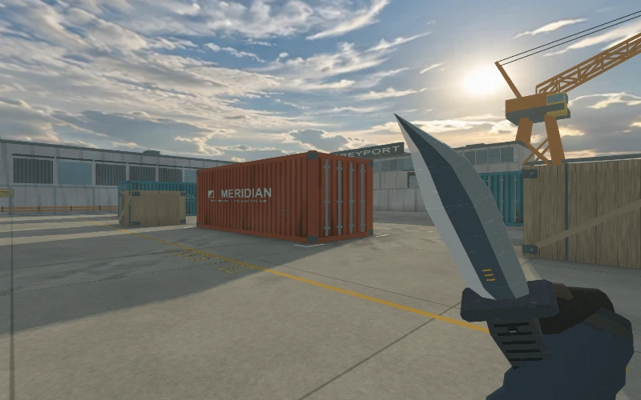
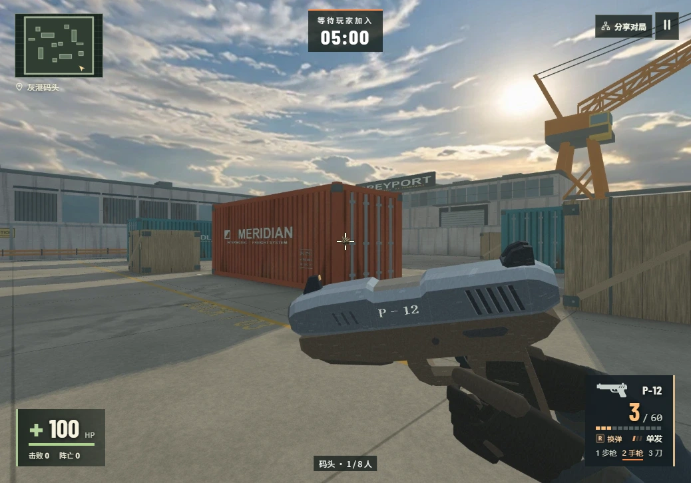
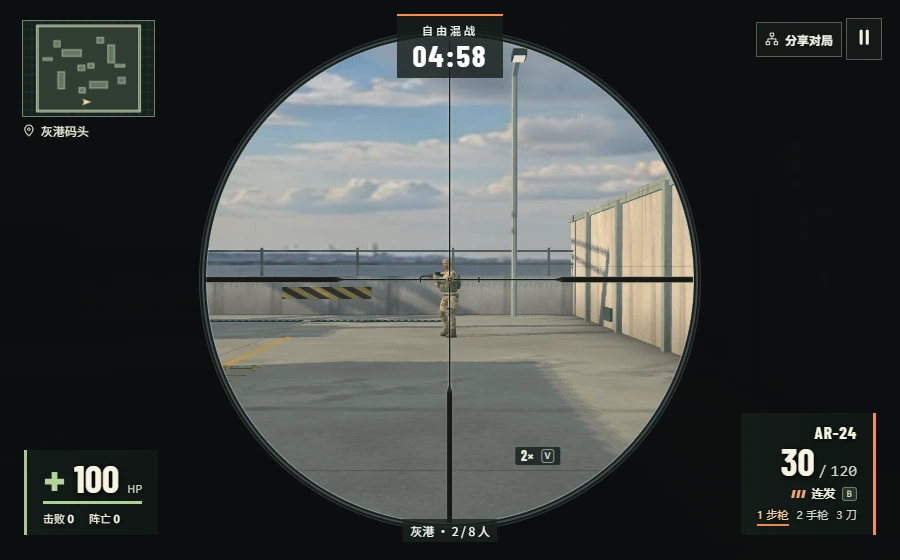
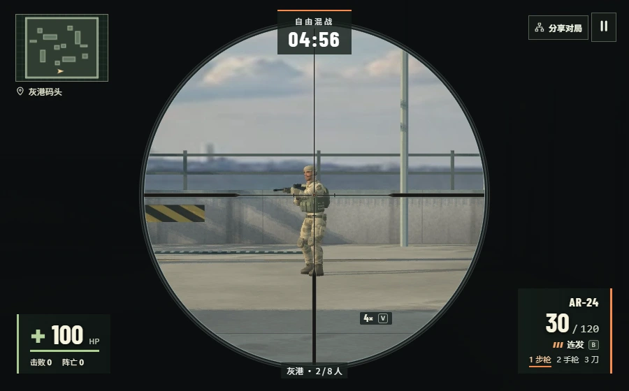
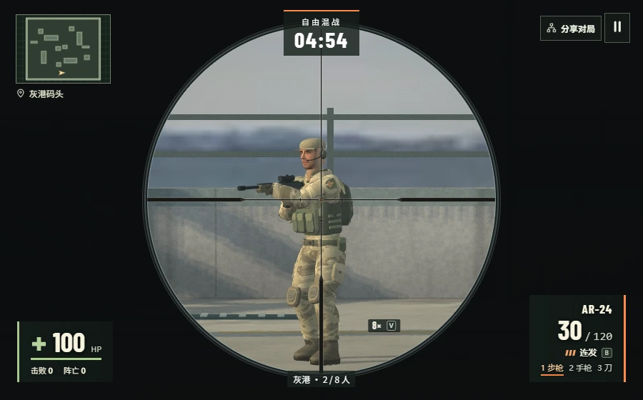
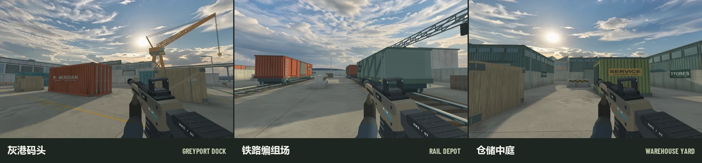

# 灰港战线 · GREYPORT ARENA

[](docs/media/gameplay.mp4)

**不到 1 MB 的局域网第一人称射击游戏。打开链接进战区，下一个打开它的人就是你的对手。**

走出货柜的阴影，低悬的太阳让前景暗下来。隔壁通道响起弹匣扣合声，你按 **B** 切到连发。灰港的三张地图、武器、角色、光照和声音，都装在一个可以双击打开的 HTML 里。

**[⬇ 下载单文件游戏](https://github.com/LiuHaiYang/greyport-arena/releases/latest/download/greyport-arena.html)**　·　[快速开局](#快速开局)　·　[看实机演示](#第一视角)　·　[键鼠操作](#键鼠操作)　·　[技术细节](#拆开这个文件)

| 玩家 | 战区 | 对局 | 复活 | 下载体积 |
| :---: | :---: | :---: | :---: | :---: |
| 2–8 人 / 对局 | 3 张 · 各 48 × 40 米 | 5 分钟自由混战 | 15 秒 | 718,536 字节 |

## 快速开局

### 朋友已经发来了对局链接

用支持 WebGL 的桌面浏览器打开朋友分享的局域网链接，即可进入同一局。房间里只有你时可以自由走动，第二位真人玩家加入后开始五分钟倒计时。

只有主机地址也可以玩。直接打开主机首页，会优先进入有一人等候的房间，其次加入有空位的进行中对局。没有可加入的对局时，系统会为你开一间。按 **Esc** 可以查看当前房间内的玩家代号。

### 我想用自己的 Windows 电脑开局

1. 下载上方的 **`greyport-arena.html`**，双击进入地图。若顶部显示 **本机预览**，点 **分享对局** 启用联机。如果本机默认端口已有兼容的服务，游戏会自动进入在线对局。
2. 点右上角 **分享对局**。看到 **对局地址** 时，直接把它发给朋友即可。看到 **让好友加入** 时，点 **复制启动命令**，在这台电脑的 **Windows PowerShell** 中粘贴并按回车。
3. 运行命令后，浏览器会打开同名、同地图的联机对局。在新页面点 **分享对局 → 复制对局地址**，把链接发给朋友。

游玩期间保持 PowerShell 窗口开启，也请房主保留游戏标签页。房主退出会结束这场对局；在启动服务的 PowerShell 窗口按回车会结束整台主机的联机服务。朋友只用浏览器，双方都无需安装 Node.js。游戏已经捕获鼠标时，可按 **Esc → 分享对局** 获取链接。

<details>
<summary><b>怎样换地图、和另一组朋友开局？</b></summary>

按 **Esc → 另开对局**，填写一个未被使用的对局名，选择地图，再点 **进入新对局**。新链接会带上这局的名字和地图。若你是原对局的房主，成功切换后原对局结束；若名称重复，你会留在原对局。每局最多 8 人，第 9 位玩家打开链接时会看到满员提示。

</details>

<details>
<summary><b>我能进，朋友却打不开链接</b></summary>

把 **分享对局** 里的完整地址发给朋友。地址中的 `localhost` 或 `127.0.0.1` 只通往打开链接的设备，`file://` 路径只指向本地文件。若使用了对局内生成的局域网地址仍打不开，请确认两台电脑在可互访的局域网中、主机的 PowerShell 窗口仍在运行，并检查主机是否允许该服务在当前专用网络接收入站连接。

</details>

## 第一视角

**六秒实机演示。** 从切换射击模式到对手倒地，再到换弹回位。片段使用游戏的 WebGL 渲染器重放双端对局记录。[观看或下载 MP4](docs/media/gameplay.mp4)

**三格武器，随时切换。** **1 / 2 / 3** 分别装备突击步枪、手枪和刀。按 **Q** 切回上一把武器，持刀近身时点左键挥击。

<details>
<summary>查看灰港码头的第一人称持刀画面</summary>



</details>

步枪可按 **B** 切换单发和连发，手枪固定单发。按住左键连发时，后坐力随连续射击累积。松手后，枪身和准星逐渐回正。枪口火光、枪声和弹壳与每次开火同步。

### P-12 手枪



按 **2** 取出 P-12。按 **F** 会在手中转过枪身，露出蓝灰色金属侧面和握把；约 1.4 秒后回到持枪姿势。检视中可以直接点射、按住右键瞄准、换弹或切回上一把武器。

右下角将当前武器、弹匣和备弹放在一起。十二格短线对应十二发子弹，剩下三发时转为琥珀色并提示 **R 换弹**。打空后滑套停在后方，空匣装填时回位；弹匣和备弹都耗尽时提示 **Q 切换武器**。

P-12 的造型和界面图形均为原创。弹药面板参考了《穿越火线》将武器、余弹与备弹集中展示的方式，状态反馈参考了《Counter-Strike 2》的 HUD 设计。[CF 界面说明](https://crossfire.z8games.com/guides_interface.html) · [CS2 界面介绍](https://www.counter-strike.net/cs2)

### 步枪倍镜

装备 AR-24，按住鼠标右键开镜，松开退镜。按 **V** 依次切换 **2× → 4× → 8× → 2×**，开镜前也能预选。镜内直接按新的视野重绘三维场景，中央细线和亮点标出瞄准位置。倍率越高，同样的鼠标位移转过的角度越小。

三张图记录了灰港码头同一机位的镜内画面。

| 2× | 4× | 8× |
| :---: | :---: | :---: |
|  |  |  |

### 换弹与命中

**换弹有重量，也有时间。** 左手离开护木，旧匣退出，新匣就位，枪身重新抬回视线。打空后的动作和耗时与提前换弹不同；中途切枪会打断装填。对手也能看到你的换弹动作。

**命中后，双方都能看清这一击的结果。** 例如步枪击中满血对手的胸腹，射手准星下显示「−27 · 73 HP」。受击者的左下角同步变为 73 HP、跳出「−27」，血条用橙色标出刚损失的部分，屏幕边缘短暂泛红。手枪击中躯干造成 34 点伤害，刀在近距离命中造成最多 55 点伤害。对手只剩 10 HP 时，最后一击显示实际扣去的 10 点。出生后有 2.2 秒保护，主动开火或挥刀会提前解除。打中受保护的对手会显示「出生保护」。

**击败有一个完整的收尾。** 画面显示被击败者的代号，角色向有空间的一侧倒下，武器落在身旁，身体短暂停留后淡出。15 秒后，对手在出生点以 100 HP 重返战斗。

| 快捷键 | 游戏武器 | 攻击方式 | 弹匣 | 常规 / 空匣换弹 |
| --- | --- | --- | ---: | --- |
| **1** | AR-24 突击步枪 | 单发 / 连发 | 30 | 1.55 / 1.92 秒 |
| **2** | P-12 手枪 | 单发 | 12 | 1.04 / 1.30 秒 |
| **3** | 战术刀 | 左键挥击 | — | — |

## 三张战区



| 地图 | 进场后会看到什么 |
| --- | --- |
| **灰港码头 · Greyport Dock** | 吊臂横过港湾，集装箱与木箱切出交错的装卸通道。从海侧回望，可以看到水面和金属各自不同的反光。 |
| **铁路编组场 · Rail Depot** | 两条铁轨穿过错位的货车。沿线是信号架、堆放的枕木和远处的筒仓；车厢之间的空隙接通两侧场地。 |
| **仓储中庭 · Warehouse Yard** | 三座库房围合出中庭。卷帘门、发电机和锯齿形厂房屋顶标出方位，外围巷道连回装卸区。 |

自动开局默认使用灰港码头，想换战区可在 **Esc → 另开对局** 中选择地图。

## 键鼠操作

| 操作 | 键鼠 | 操作 | 键鼠 |
| --- | --- | --- | --- |
| 前进 / 后退 | **W / S** | 左右平移 | **A / D** |
| 检视手枪 | **F** | 结束检视并开火 | **鼠标左键** |
| 蹲下 / 起身 | **按住 / 松开 Ctrl 或 C** | 转动视角 | **移动鼠标** |
| 开火 / 挥刀 | **鼠标左键** | 瞄准 / 步枪开镜 | **按住鼠标右键** |
| 选择 2× / 4× / 8× | **V** | 退镜 | **松开鼠标右键** |
| 步枪单发 / 连发 | **B** | 换弹 | **R** |
| 步枪 / 手枪 / 刀 | **1 / 2 / 3** | 上一把武器 | **Q** |
| 循环切换武器 | **鼠标滚轮** | 跳跃 | **空格** |
| 疾跑 | **Shift + 移动** | 战斗菜单 | **Esc** |

第一次点击画面启用鼠标视角，再按左键攻击。按住蹲键时视角降低，仍可按 W 向前蹲行。松开蹲键会平滑起身。对手能看到你的屈膝、迈步、腾空和落地，命中范围随动作同步变化。右下角高亮当前武器槽，**Esc → 武器库** 可设定下次入场的装备。

## 拆开这个文件

仓库根目录的 [`index.html`](index.html) 就是完整游戏。两张 WebP 贴图和一份 WOFF2 字体随文件载入，其余场景、武器、动作和音效由代码生成。局域网服务源码也在 HTML 内，断开互联网仍能开局。上面的实机截图和演示视频只用于项目介绍。

| 技术 | 在游戏里做了什么 |
| --- | --- |
| **原生 JavaScript + WebGL** | 三件第一人称武器用索引复用同一面的顶点。手枪在本机和远端视角共用滑套动画的时间曲线。每张地图用 64 KiB 的单通道贴图保存地面接触阴影。 |
| **全景天空与定向光照** | 2048 × 1024 的港口全景与世界空间的太阳方向对齐。地图载入时计算静态阴影和太阳遮挡；转动视角时，曝光、水面与玻璃反射、金属高光随之变化。 |
| **角色骨骼与程序动画** | 持枪、移动、换弹、后坐与倒地由姿态计算驱动。第一人称手与枪单独绘制，其他玩家通过同步的动作状态在本地重建动画。 |
| **Web Audio 合成** | 枪声、弹匣碰撞、脚步和命中提示由振荡器、噪声、滤波器与音量包络现场合成，节省采样文件体积。 |
| **独立仿真时钟** | 游戏逻辑目标频率为 40 Hz，绘制使用 `requestAnimationFrame`。连发按仿真时间安排；标签页卡顿恢复后不会一次补打一串积压子弹。 |
| **HTTP + Server-Sent Events** | 浏览器通过 HTTP POST 发送输入，联机服务通过 SSE 转发消息。房主约每秒广播 15 次状态。各端在快照之间平滑显示远端移动。开枪时，房主按射手画面对应的时刻检查角色位置和掩体，判定伤害后将剩余 HP 发给双方。 |
| **单文件开服** | HTML 内嵌 C# 联机服务源码。主机的 Windows PowerShell 从打开的文件中读取、编译并运行这段代码，随后向局域网提供同一份 HTML。 |

## 从源码构建

直接游玩可使用已经提交的 `index.html`。修改游戏时，在仓库根目录使用 Node.js 18 或更高版本运行以下命令，构建器只使用 Node 内置模块。

```sh
node scripts/build.mjs
node scripts/verify.mjs
```

想改武器手感，从 [对局参数](src/game.js) 和 [第一人称动作](src/weapon.js) 入手。地图、光照和第三人称角色在 [场景渲染器](src/arena.js) 中。联机代码分为 [浏览器客户端](src/room-lan.js) 和 [Windows 服务](src/room-server.cs)。

<details>
<summary><b>复现构建与回归检查</b></summary>

```sh
node scripts/build.mjs --check
node tests/gameplay.cjs --html
node tests/movement.cjs
node tests/poses.cjs
node tests/optics.cjs --html
node tests/three-player.cjs --html
```

第一条命令在内存中重新构建游戏，逐字节比对仓库中的 HTML。战斗测试检查身体命中、掩体、移动目标和 15 秒复活。三端测试覆盖房主打加入者、加入者之间交手、旁观者收到的反馈，以及玩家离开后的角色清理。移动和姿态测试检查插值、屈膝、腾空、落地和换弹。在 Windows 上还可运行 `node tests/lan-host.mjs`，实际启动内嵌服务，检查自动匹配、同一链接并发进场、满员提示和重名拦截。

</details>

当前 HTML 的 SHA-256 为 `b407649c05646326e2e12a9b2ebed2c3d586a68f6e5e77366ecf6168887423d4`。

## 许可与素材

项目采用 [MIT 许可证](LICENSE)。港口天空和角色面部贴图为本项目生成，地图截图和动作演示取自游戏引擎。内嵌字体 **Barlow Condensed Bold** 来自 The Barlow Project Authors，按 [SIL Open Font License 1.1](src/assets/OFL.txt) 分发。
